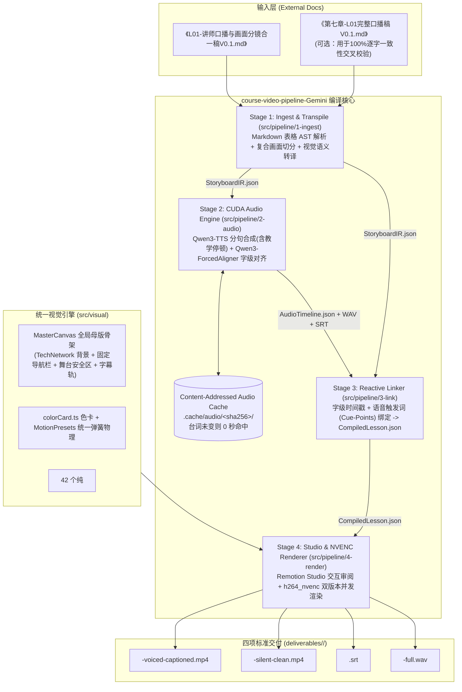

# `course-video-pipeline-Gemini` 架构设计方案（v1.0）

| 属性 | 定义 |
| :--- | :--- |
| **项目根目录** | [`/projects/gaoxiang/course-video-pipeline-Gemini`](file:///projects/gaoxiang/course-video-pipeline-Gemini) |
| **标准输入源** | [`/projects/gaoxiang/information-systems-project-management-4e-course-Gemini/docs/`](file:///projects/gaoxiang/information-systems-project-management-4e-course-Gemini/docs/%E7%AC%AC7%E7%AB%A0/L01-%E8%AE%B2%E5%B8%88%E5%8F%A3%E6%92%AD%E4%B8%8E%E7%94%BB%E9%9D%A2%E5%88%86%E9%95%9C%E5%90%88%E4%B8%80%E7%A8%BFV0.1.md) 下的《讲师口播与画面分镜合一稿V0.1.md》 |
| **本地 AI 引擎** | TTS：[`/projects/gaoxiang/qwen3-tts`](file:///projects/gaoxiang/qwen3-tts)（`Qwen3-TTS-12Hz-1.7B-VoiceDesign`）<br>对齐：[`/projects/gaoxiang/qwen3-forced-aligner`](file:///projects/gaoxiang/qwen3-forced-aligner)（`Qwen3-ForcedAligner-0.6B`） |
| **视觉资产底座** | 继承 [`course-video-pipeline2`](file:///projects/gaoxiang/course-video-pipeline2/07-remotion-templates/process/src) 的 `TechNetwork` 全局背景、[`colorCard.ts`](file:///projects/gaoxiang/course-video-pipeline2/07-remotion-templates/process/src/tokens/colorCard.ts) 色卡、42 个纯 `<g>` 原子图形与 9 类基础模板 |
| **算力与加速** | NVIDIA GeForce RTX 5060 Ti (16GB VRAM)，CUDA 13.2 / PyTorch cu128 BF16 + FFmpeg `h264_nvenc` |
| **审核交互模式** | 原生轻量 `npm run studio`（Remotion Studio Web 播放器，支持时间轴拖拽与逐帧动效审阅） |
| **标准四项交付** | `voiced-captioned.mp4`、`silent-clean.mp4`、`<lessonId>.srt`、`<lessonId>-full.wav` |

---

## 一、 核心架构思想：从“九阶段文件接力”演进为“四阶段视频编译器”

在 [`course-video-pipeline2`](file:///projects/gaoxiang/course-video-pipeline2) 中，为了应对非结构化文本，系统拆成了 `01~09` 九个阶段目录并通过文件指针传递状态，导致每改一处视觉参数都要走繁琐的 `repair -> register -> resume -> rebind` 流程。

而在 `course-video-pipeline-Gemini` 中，输入已经是高度结构化的《讲师口播与画面分镜合一稿V0.1》，并且审核直接在 `npm run studio` 中完成。因此，我们将架构收敛为**“单一契约核心（`contracts/`）+ 四阶段编译器管线（`1-ingest` $\rightarrow$ `2-audio` $\rightarrow$ `3-link` $\rightarrow$ `4-render`）+ 内容寻址缓存（CAS）”**：



---

## 二、 目录结构设计（`/projects/gaoxiang/course-video-pipeline-Gemini`）

```text
/projects/gaoxiang/course-video-pipeline-Gemini
├── package.json
├── tsconfig.json
├── remotion.config.ts
├── docs/
│   └── architecture/
│       └── architecture-design-v1.0.md      # 本架构规范
├── contracts/                               # 【唯一事实来源】Zod 契约层
│   ├── storyboard-ir.schema.ts              # Stage 1 产出的结构化分镜中间表征契约
│   ├── audio-timeline.schema.ts             # Stage 2 产出的字级时间轴与音频元数据契约
│   ├── visual-props.schema.ts               # 11 类视觉模板的判别联合 Payload 契约（严禁硬编码样式）
│   ├── compiled-lesson.schema.ts            # Stage 3 产出的终态音画绑定数据契约（供 Studio 与 Render 消费）
│   └── delivery-manifest.schema.ts          # Stage 4 四项交付物与哈希审计契约
├── src/
│   ├── cli/                                 # 极简命令行入口
│   │   ├── compile.ts                       # npm run compile -- --input=<md路径> --lesson=ch07-L01
│   │   └── render.ts                        # npm run render  -- --lesson=ch07-L01
│   ├── pipeline/
│   │   ├── 1-ingest/                        # 阶段 1：合一稿解析与视觉语义转译
│   │   │   ├── markdown-table-parser.ts     # 解析课前速览卡、分段 4 列表格、自检表
│   │   │   ├── subscene-splitter.ts         # 识别【画面 1A】/【画面 1B】并按口播段落切分子镜头
│   │   │   ├── pause-extractor.ts           # 识别“给你两秒钟看一眼”/【停顿 2s】注入显式停顿指令
│   │   │   └── visual-transpiler.ts         # 将第 3 列视觉动作转译为强类型模板 Payload 与触发锚点
│   │   ├── 2-audio/                         # 阶段 2：本地 Qwen3 语音合成与强制对齐
│   │   │   ├── audio-runner.ts              # 基于内容 SHA-256 的缓存调度器（台词不变零耗时）
│   │   │   ├── tts_worker.py                # 调用 /projects/gaoxiang/qwen3-tts (.venv, cuda:0, bf16)
│   │   │   ├── align_worker.py              # 调用 /projects/gaoxiang/qwen3-forced-aligner (.venv, cuda:0)
│   │   │   └── srt-exporter.ts              # 确定性字幕切分与 UTF-8 SRT 导出
│   │   ├── 3-link/                          # 阶段 3：响应式音画链接器
│   │   │   ├── cue-point-resolver.ts        # 将视觉触发词（如“直接选 C”）映射为精确帧号
│   │   │   └── assembler.ts                 # 合并生成 workspaces/<lessonId>/compiled-lesson.json
│   │   └── 4-render/                        # 阶段 4：双版本 NVENC 渲染与媒体探针核验
│   │       ├── nvenc-renderer.ts            # 调用 Remotion + h264_nvenc 渲染有声/无声双版本
│   │       └── media-verifier.ts            # ffprobe 校验轨道数、时长、帧率与像素一致性
│   └── visual/                              # Remotion 视觉渲染引擎（供 Studio 与 Render 共享）
│       ├── index.ts
│       ├── Root.tsx                         # 注册 CourseVideo 与 TemplateShowcase
│       ├── shell/
│       │   ├── MasterCanvas.tsx             # 全局母版骨架（TechNetwork + 顶部章节目导航 + 舞台区 + 字幕轨）
│       │   ├── HeaderBreadcrumb.tsx         # 顶部常驻：章节标题、当前分镜进度胶囊
│       │   └── CaptionsOverlay.tsx          # 底部口播字幕组件（仅 includeCaptions=true 时挂载）
│       ├── tokens/
│       │   ├── colorCard.ts                 # 继承自 pipeline2 的色卡 v1.1
│       │   └── motionPresets.ts             # 全局统一弹簧参数、瀑布流帧差、划线/脉冲时长
│       ├── backgrounds/
│       │   └── tech-network/                # 继承自 pipeline2 的全局唯一动态背景
│       ├── primitives/                      # 继承自 pipeline2 的 42 个无状态 <g> 原子图形
│       └── templates/                       # 9 个既有业务模板 + 2 个新增软考核心模板
│           ├── SceneRouter.tsx              # 11 类 visualType 判别联合穷尽路由
│           ├── ExamQuizCard.tsx             # 【新增】单道历年真题互动解析卡（倒计时/划红叉/批注/打勾）
│           ├── DualQuizBattleCard.tsx       # 【新增】双真题同屏对决卡（适配 L01-S04-2 / L02-S03-2,S04-2）
│           ├── ProcessTimeline.tsx          # 继承并支持盖印章（如“★不可缺少”）与底部对比轨道
│           ├── MultiCards.tsx               # 继承并支持防坑警示横幅（⚠️ 考场防坑）
│           ├── TableTemplate.tsx            # 继承并支持王牌防坑对照表高亮
│           └── ...                          # 其余既有模板（LayeredArchitecture, TitleCard, AtomicCombo 等）
├── public/
│   ├── fonts/                               # 复用标准字体包
│   └── audio -> ../workspaces               # 软链接零拷贝访问各课程生成的 WAV 音频
├── .cache/
│   └── audio/                               # 内容寻址音频缓存池（按句子/段落哈希存储 WAV 与对齐结果）
├── workspaces/                              # 每节课的编译中间态（Git 可追踪或随时重建）
│   └── <lessonId>/                          # 例如 ch07-L01
│       ├── storyboard-ir.json
│       ├── audio-timeline.json
│       └── compiled-lesson.json             # npm run studio 直接实时监听此文件！
└── deliverables/                            # 最终四项标准交付物落盘区
    └── <lessonId>/
        ├── <lessonId>-voiced-captioned.mp4
        ├── <lessonId>-silent-clean.mp4
        ├── <lessonId>.srt
        ├── <lessonId>-full.wav
        └── delivery-manifest.json
```

---

## 三、 四阶段核心模块详细设计

### 3.1 Stage 1：`1-ingest`（合一稿 AST 解析与视觉语义编译）

直接面向《讲师口播与画面分镜合一稿V0.1.md》的表格结构进行确定性解析：

1. **三段式 Markdown AST 解析（`markdown-table-parser.ts`）**：
   * **课前速览卡提取**：解析第 1 节表格，提取 `chapterTitle`、`estimatedDuration`、`learningGoals`、`coreVisualAssets`、`examAnchors`。
   * **分段分镜表提取**：解析第 2 节各段（`段 1` ~ `段 N`）的四列表格，提取：
     * 第 1 列 $\rightarrow$ `rawSceneId`（如 `S01-1`）、`sceneTitle`（`历年考情与全书切入点`）、`estimatedSeconds`（`55`）；
     * 第 2 列 $\rightarrow$ `narrationBlocks`（按 `<br><br>` 保留自然段结构）；
     * 第 3 列 $\rightarrow$ `visualSpecRaw`（解析 `**【画面 1A：...】**` 标题、有序列表项、引用块中的真题题面、以及 `【停顿 2s 后动画】` 动作块）；
     * 第 4 列 $\rightarrow$ `pedagogicalIntent`。
   * **双稿交叉核验（可选防呆）**：若同目录存在对应的《完整口播稿V0.1.md》，自动比对两者的纯口播文本，确保 **100% 逐字一致**，防止合一稿漏字。

2. **复合镜头自动裂变（`subscene-splitter.ts`）**：
   * 在《合一稿》中，单个表格行可能包含多个独立画面块（例如 `L01` 的 `S01-1` 内含 `【画面 1A：考情速览卡】` 和 `【画面 1B：项目源头时间轴】`；`L02` 的 `S04-1/S04-2` 内含上下半部）。
   * 当检测到单行存在 $\ge 2$ 个独立 `【画面 ...】` 块且对应不同视觉结构时，自动将其裂变为子场景序列 `S01-1a` 与 `S01-1b`，并将该行的口播自然段按语义对位分配给对应子场景。
   * **收益**：每个子场景在 Remotion 中只渲染一个干净的模板，画面不拥挤、不重排。

3. **教学停顿指令提取（`pause-extractor.ts`）**：
   * 当口播中出现 `“给你两秒钟看一眼”`、`“给你两秒钟扫一下四个选项”` 或第 3 列出现 `【停顿 2s 后动画】`、`【停顿 1.5s 后动画】` 时，自动在该句末尾注入显式停顿指令 `{ type: "pedagogical-pause", durationMs: 2000 }`。

---

### 3.2 Stage 2：`2-audio`（基于 5060Ti 的 Qwen3 语音与字级对齐引擎）

直接调用本地已验证的虚拟环境，不改动 `/projects/gaoxiang/qwen3-tts` 与 `/projects/gaoxiang/qwen3-forced-aligner` 的任何源码或权重：

1. **突破 150 字限制的常驻批处理合成（`tts_worker.py`）**：
   * 调用 `/projects/gaoxiang/qwen3-tts/.venv/bin/python`，在单次进程中将 `Qwen3-TTS-12Hz-1.7B-VoiceDesign` 加载至 `cuda:0`（`bfloat16`，仅需 `0.9s`）。
   * 按标点将每个分镜的口播切分为短句（每句 $\le 80$ 字，远低于 150 字上限），逐句推理并通过 `trim_edges` 裁剪首尾空白，随后按确定性停顿策略拼接：
     * 逗号/顿号：`300ms`；分号/冒号：`380ms`；句号/问号/叹号：`480ms`；
     * **教学互动停顿（真题思考时间）**：精准插入 `1500ms` 或 `2000ms` 纯静音段！
2. **内容寻址缓存（Content-Addressed Audio Cache）**：
   * 对每个分镜（甚至每个分句）计算 `sha256(clauseText + voiceInstruct + seed + pausePolicy)`，缓存于 `.cache/audio/`。
   * **架构价值**：当你调整画面布局、修改卡片文字或在 `npm run studio` 中调试动效时，只要口播台词没改，重新编译只需 **0.1 秒**即可直接复用缓存的 WAV 与对齐数据！
3. **CUDA 字级强制对齐（`align_worker.py`）**：
   * 调用 `/projects/gaoxiang/qwen3-forced-aligner/.venv/bin/python`，加载 `Qwen3-ForcedAligner-0.6B` 至 `cuda:0`（`bfloat16`）。
   * 对每个分镜音频生成逐字时间戳 `tokens: Array<{ char: string, startMs: number, endMs: number }>`，并基于分句边界与标点导出 `<lessonId>.srt`。

---

### 3.3 Stage 3：`3-link`（语音锚点驱动的响应式音画链接器）

这是消除“口播与画面动画脱节”的核心模块（[`cue-point-resolver.ts`](file:///projects/gaoxiang/course-video-pipeline-Gemini)）：

* **传统痛点**：如果把真题公布答案的动画写死在第 15 秒，一旦 TTS 语速变化，讲师还在读 C 选项，答案就已经提前高亮了。
* **Cue-Point 语音锚点绑定机制**：
  * 每个模板支持一组语义动作锚点（`cuePoints`）。例如在 `L01 S02-3`（真题 1）中：
    1. `thinkingStart`：锚定口播词 `“给你两秒钟看一眼”` 的 `endMs` $\rightarrow$ 画面启动 2 秒倒计时进度条；
    2. `eliminate_2`：锚定口播词 `“机会可行性研究是命题人塞进来的干扰项，把它剔掉”` $\rightarrow$ 画面给 `②机会可行性研究` 盖上红叉并压暗 A/B/D；
    3. `reveal_C`：锚定口播词 `“直接选 C”` 的 `startMs` $\rightarrow$ 画面高亮 C 选项并打金勾；
    4. `showTip`：锚定口播词 `“这里需要提示的是”` 的 `startMs` $\rightarrow$ 底部弹出蓝底应试提示条。
  * `cue-point-resolver.ts` 在该分镜的字级 `tokens[]` 中做子串/模糊匹配，将毫秒时间自动转换为精确的镜头内相对帧号 `localFrame = Math.round((tokenMs - sceneStartMs) * fps / 1000)`。

---

### 3.4 Stage 4：统一视觉引擎与 `npm run studio` 极简审阅流

#### 1. 风格一致性保障：三层锁死
* **底层资产完全继承**：直接迁移 `course-video-pipeline2` 的 `TechNetwork` 背景、`colorCard.ts` 与 42 个纯 `<g>` 原子图形。
* **中层母版容器锁死（`MasterCanvas.tsx`）**：
  * **顶栏（Header, 0~110px）**：左侧显示课程与章节徽章（如 `第 7 章 项目立项管理 · L01`），右侧显示分镜进度与当前镜头标题（如 `S02-3 历年真题锚点 1`）。
  * **舞台安全区（Stage, 110~910px）**：所有业务模板严格在此 `1720 × 800` 容器内渲染，字号、行高、卡片圆角全部引用 `colorCard.ts` Token。
  * **底栏（Footer, 910~1080px）**：专供口播字幕轨使用，确保口播字幕绝不遮挡任何教学卡片或底部的“实务 vs 应试提示条”。
* **顶层契约禁绝样式漂移**：`visual-props.schema.ts` 只接收语义枚举（如 `tone: "gold" | "cyan" | "red"`、`badge: "core-must-do"`），不接收任何自定义 Hex 色值或像素偏移。

#### 2. 针对《合一稿》专门补齐的 2 个高阶软考模板
在保留既有 9 个模板的基础上，使用现有的 42 个原子图元与 `colorCard.ts` 组合出 2 个软考专属模板：
1. **`ExamQuizCard`（单题互动解析卡）**：
   * 覆盖 `L01 S02-3 / S03-2 / S04-2`、`L02 S02-2 / S05-2` 等全部单题解析场景。
   * 支持：年份批次胶囊、题干关键词标黄、组合题编号（①②③④⑤）单独划叉、ABCD 选项状态切换（正常 $\rightarrow$ 标红错误词并附右侧批注 $\rightarrow$ 正确答案金框打勾）、右侧同源题关联小卡（如 `L01 S04-2` 的一题带三题）、底部应试提示横幅。
2. **`DualQuizBattleCard`（双真题同屏对决卡）**：
   * 覆盖 `L02 S03-2`（真题 2 & 3 左右同屏）、`L02 S04-2`（防坑对照表 + 双真题同屏对决）。
   * 支持左右双栏或上表下双题布局，按讲师口播先后顺序依次激活左题与右题的排错/选优动画。

#### 3. 原生轻量审核与硬件加速渲染工作流
日常生产只需 **3 条命令**：

```bash
# 1. 编译合一稿（自动完成 AST 解析 + Qwen3-TTS 合成 + Qwen3 字级对齐 + CuePoint 帧绑定）
npm run compile -- --input="/projects/gaoxiang/information-systems-project-management-4e-course-Gemini/docs/第7章/L01-讲师口播与画面分镜合一稿V0.1.md" --lesson=ch07-L01

# 2. 打开原生 Remotion Studio 在浏览器拖动进度条、逐帧审阅动效（修改配置支持毫秒级热重载）
npm run studio

# 3. 审阅满意后，一键启动 5060Ti h264_nvenc 硬件编码导出四项标准交付物
npm run render -- --lesson=ch07-L01
```

---

## 四、 实施路线图（Phased Implementation Plan）

如果确认本架构方案，我们将按以下 **4 个清晰阶段** 在 `/projects/gaoxiang/course-video-pipeline-Gemini` 落地：

1. **Phase 1：工程底座初始化与视觉资产迁移**
   * 初始化 `/projects/gaoxiang/course-video-pipeline-Gemini`（TypeScript、Remotion 4、Zod 4）；
   * 迁移 `course-video-pipeline2` 的 `colorCard.ts`、`TechNetwork` 背景、42 个纯 `<g>` 原子图形与 9 个基础模板；
   * 搭建 `MasterCanvas` 全局母版骨架，并新增 `ExamQuizCard` 与 `DualQuizBattleCard` 两个软考真题模板。
2. **Phase 2：契约层与 Stage 1 合一稿编译器（`1-ingest`）**
   * 实现 `contracts/` 全套 Zod 契约；
   * 实现《合一稿V0.1》Markdown 表格解析器、复合画面自动裂变器与教学停顿提取器，并以第 7 章 `L01`、`L02`、`L03` 三篇真实合一稿做 100% 解析验证。
3. **Phase 3：Stage 2 Qwen3 CUDA 音频引擎与 Stage 3 响应式链接器（`2-audio` & `3-link`）**
   * 编写对接 `/projects/gaoxiang/qwen3-tts` 与 `/projects/gaoxiang/qwen3-forced-aligner` 的 CUDA 批处理脚本与内容寻址缓存池；
   * 实现 `cue-point-resolver.ts`，完成 `ch07-L01` 的完整音画编译并在 `npm run studio` 中就绪。
4. **Phase 4：Stage 4 NVENC 硬件加速渲染与四项交付核验（`4-render`）**
   * 实现 `h264_nvenc` 双版本（有声带字幕 / 无声无字幕）渲染器与 `ffprobe` 交付核验脚本。
