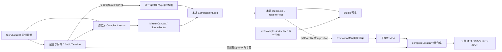

# 项目架构说明 V2.0

代码核对日期：2026-11-03；最近同步：2026-11-07，更新独立课时入口、公共依赖边界及调用方指定导出入口的实现与限制。本文说明当前工程的结构、数据流与主要调用关系，供理解工程或修改相关实现时按需查阅。

日常制作按[AI互动流程总结](AI互动流程总结V0.1.md)推进，组件参数和调用示例查[公共能力索引](公共能力索引V0.1.md)。画面、字幕和音频要求分别由[视频画面规范V0.2](视频画面规范V0.2.md)、[字幕规范V0.2](字幕规范V0.2.md)、[音频规范V0.2](音频规范V0.2.md)规定，本篇不增加开工必读项。

理解当前任务涉及的实现时，可直接定位：独立课时入口看 3.1，编译数据与母版看 3.2 和第四节，导出看第五节，已知实现限制看第七节。日常教学设计从制作流程进入。

## 一、总体结构

项目使用 React、TypeScript 和 Remotion 编排教学画面，Python worker 负责 Qwen3 配音与强制对齐，FFmpeg / ffprobe 负责媒体处理与参数检查。

用户输入位于 `docs/lessons/<章节>/<课时>/input/`。口播与教材先经过分镜、分组和画面设计，再形成课时组件或结构化分镜数据。输入目录本身不会自动触发制作，现有编译 CLI 也不直接接受任意纯口播稿。

当前有两种课时组织方式，均由本课独立入口注册所需 Composition。公共示例另用自己的入口：

独立课时组件可以复用音频管线和公共视觉能力，也可以读取本课已准备的数据。制作新课时沿用适合本课的现有接入方式，无需先统一两条路线。图中导出部分是当前双版本交付流程，干净版独立保留；原有导出入口的行为见第五节。

## 二、目录职责与公共能力边界

版本库保留公共框架、必要文档、独立公共示例和流程演示课 `test01`。其他课程的私有代码、数据和媒体在本地或归档位置维护，不纳入本仓库提交；具体规则见 [README 的版本管理说明](../../README.md#五版本管理与素材保存)。移除其他课程后，公共示例与 test01 应能独立运行。

| 位置 | 职责 |
| --- | --- |
| [contracts/](../../contracts) | Zod 数据契约：分镜、音频时间轴、视觉 payload、编译课时、图元配置和交付清单 |
| [src/pipeline/](../../src/pipeline) | 输入解析、音频生成与对齐、音画绑定、通用媒体交付 |
| [src/visual/primitives/](../../src/visual/primitives) | 原子图形与注册表，供组合组件和课时设计复用 |
| [src/visual/kit/](../../src/visual/kit) 与 [templates/](../../src/visual/templates) | 组合组件、布局、动效与数据驱动模板 |
| [src/visual/shell/](../../src/visual/shell)、[backgrounds/](../../src/visual/backgrounds)、[tokens/](../../src/visual/tokens) | 母版、导航、字幕呈现、背景、颜色与动效参数 |
| [src/visual/caption-export/](../../src/visual/caption-export) | 独立字幕截帧入口，复用 `CaptionsOverlay`，不加载课程注册表或教学场景 |
| [src/examples/](../../src/examples) | 独立公共示例的说明、代码、必要数据、素材与参考成果 |
| [src/lessons/](../../src/lessons) | 课时内容、专用图解、组件、入口声明与注册信息 |
| [src/cli/](../../src/cli) 与 [scripts/](../../scripts) | CLI、共享预览与导出入口，以及必要的课时准备、组装和讲义脚本 |

课程专用设计继续调用原子组件、kit 和公共方法。公共目录中的组件仍有使用范围限制，部分模板包含特定教学内容；能否覆盖参数或替换局部，以真实接口和公共能力索引为准。

课程调用公共能力；公共实现不导入具体课程或内置课程路径，课程之间不互相依赖。公共函数通过参数接收本课数据、组件与路径。`workspaces/` 只保存本课私有内容，不存放公共实现；公共示例的固定输入与素材留在本例目录。

## 三、课时接入与画面调用关系

公共示例统一位于 [src/examples/](../../src/examples/README.md)。题卡与表格分别在各自 `compositions.ts` 声明预览，由 [src/examples/index.tsx](../../src/examples/index.tsx) 汇总；各自独立 `index.tsx` 复用同一份声明，不导入课程。标准 `QuizCard…` ID 对应已审核示例，旧原型使用 `LegacyQuizCard…`；讲义继续调用 `scripts/handout.py`，不注册到 Studio。

默认公共预览入口是 [src/examples/index.tsx](../../src/examples/index.tsx)，只注册独立公共示例。演示课入口是 [src/lessons/test01/studio.tsx](../../src/lessons/test01/studio.tsx)，只注册这一课。公共代码不导入课程，课程之间也不互相导入。

### 3.1 独立课时组件

课时入口用 [CompositionSpec](../../src/visual/composition-types.ts) 声明组件、ID、时长、帧率、画幅和可选 Props。该课 `studio.tsx` 用 [courseRoot](../../src/visual/register-course.tsx) 组成根组件，并在这个入口文件里调用 `registerRoot`。Remotion CLI 只认入口文件里的 `registerRoot`。声明方式可参考 [quiz/compositions.ts](../../src/examples/quiz/compositions.ts)。演示课见 `src/lessons/test01/studio.tsx`。

组件自行组合画面、音轨、字幕和时间数据，`defaultProps` 只能放可序列化的数据。函数组件留在课程入口的闭包里，不放进 `defaultProps`。

整课可调用 [resolveFullLessonGroups](../../src/pipeline/resolve-full-lesson-groups.ts)，用组装记录里的 `composition` 字段查找分组组件。顺序、起始帧、时长取组装记录，组件参数取匹配到的 `CompositionSpec`，不依赖两个数组的下标一致。找不到时错误包含课时、分组和缺失的 composition id。同文件的 `groupPreviewSpecs` 在预览数据为 `null` 或 `undefined` 时返回空列表；正式整课仍须解析全部组装记录。

该方法只负责配对，不自动生成整课。课时整课组件用 `Sequence` 放置各组、关闭组内音轨与口播字幕，再在外层挂载同一时间轴的整轨音频和字幕。音频拼接、分组偏移及预览数据准备仍由课时脚本处理。

### 3.2 编译数据与公共母版

课程入口提供本课数据和专用组件。公共母版不读取课程列表。

[MasterCanvas](../../src/visual/shell/MasterCanvas.tsx) 按 `CompiledLesson` 组织一层背景、可选音轨、场景 Sequence、头部导航和口播字幕。它将场景交给 [SceneRouter](../../src/visual/templates/SceneRouter.tsx)：

- 普通 `visualType` 选择对应公共模板，并传入 `payload`；需要时传入 `cues`。
- `chapter-local` 通过 `payload.key` 查本课组件，传入 `payload.data` 和 `cues`。
- `headerMode: "chapter"` 的场景由本课组件绘制导航，母版跳过，避免重复。

需要公共母版的课程，在自己的入口里把课时数据传给 `props.lesson`，并把专用组件表留在闭包中传给 `props.chapter`。母版负责布局、音轨、字幕和场景，不把某一节课当作公共默认预览。演示课 test01 使用自己的分组组件和 `Test01L01Full` / `Test01L01FullSilentClean`，不经过这套编译注册。入口加载时不读取 `workspaces/current-lesson.json`。

[applyLessonPatches](../../src/pipeline/lesson-patches.ts) 可在调用它的课时入口按场景 ID 合并画面数据：对象递归合并、数组整体替换。它不自动重做配音、字幕或对齐，也不会因出现一个补丁文件就被所有入口读取。

## 四、音频、字幕与时间轴

### 4.1 通用编译链

`npm run compile` 进入 [src/cli/compile.ts](../../src/cli/compile.ts)，依次调用：

| 阶段 | 主要调用 | 产物 |
| --- | --- | --- |
| 输入解析 | [compileMarkdownToStoryboardIR](../../src/pipeline/1-ingest/ingest-compiler.ts)：解析分镜表、拆分复合场景、切分口播、提取停顿与视觉信息 | `storyboard-ir.json` |
| 配音与对齐 | [runAudioEngine](../../src/pipeline/2-audio/audio-runner.ts)：运行 TTS worker、对齐 worker，组织音频时间与字幕 | WAV、`tts-output.json`、`aligned-tokens.json`、`audio-timeline.json`、SRT |
| 音画绑定 | [linkAndAssembleLesson](../../src/pipeline/3-link/assembler.ts)：结合分镜和音频，调用 `resolveSceneCuePoints`，计算场景帧区间 | 只写本课 `compiled-lesson.json`。不更新共享激活文件 |

编译 CLI 处理现有口播与分镜合一稿格式，必须显式指定本课 `--input`、`--lesson`，缺失时直接报错；`--audio-mode` 默认 CUDA。课时准备脚本也可生成 IR 或组装本课数据，具体入口查公共能力索引。

### 4.2 关键数据

| 数据 | 定义位置与职责 |
| --- | --- |
| `StoryboardIR` | [storyboard-ir.schema.ts](../../contracts/storyboard-ir.schema.ts)：口播分句、停顿指令、视觉类型、payload 和待定位的 `cueSpecs` |
| `AudioTimeline` | [audio-timeline.schema.ts](../../contracts/audio-timeline.schema.ts)：实际音频路径、时长、逐场景 token、字幕与引擎信息 |
| `CompiledLesson` | [compiled-lesson.schema.ts](../../contracts/compiled-lesson.schema.ts)：画幅、场景帧区间、已解析 cues、字幕及公开音频路径 |
| `ResolvedCuePoint` | [visual-props.schema.ts](../../contracts/visual-props.schema.ts)：动作、目标、触发毫秒、场景内局部帧及匹配方式 |

实际音频与对齐结果决定时序。[resolveSceneCuePoints](../../src/pipeline/3-link/cue-point-resolver.ts) 将口播锚点转换为场景局部帧，并记录 `token-exact`、`token-fuzzy` 或 `fallback-ratio`。模糊匹配和比例回退需要结合实际讲解核对，不能视为已经精确对齐。

字幕由原文与 token 生成，视频和 SRT 使用同一版本数据。局部时间、整课时间和样段归零要保持一致；具体切分、静音窗口及同步要求按现行字幕、音频规范执行。

### 4.3 Python worker 与缓存

[tts_worker.py](../../src/pipeline/2-audio/tts_worker.py) 按分句生成音频，插入停顿并装配分镜和整轨；[align_worker.py](../../src/pipeline/2-audio/align_worker.py) 对实际分镜音频做强制对齐，再加上分镜偏移得到时间戳。

- 配音缓存位于 `.cache/audio/clauses/`，当前键包含停顿策略版本、seed、音色指令和分句文本。
- 对齐缓存位于 `.cache/audio/align/`，当前按分镜 WAV 的 SHA-256 保存相对 token 时间。
- `synthetic` 模式产生测试静音和估算 token，不能作为课程配音或精确同步的依据。

模型权重、各自 Python 环境和本机工具路径由现有环境提供，详见 [README](../../README.md)的外部环境说明，不随课程代码自动恢复。

## 五、预览、画面渲染与公共合成

`npm run studio` 与 `npm run dev` 使用 [scripts/studio.mjs](../../scripts/studio.mjs) 启动预览，默认入口是 `src/examples/index.tsx`。演示课使用 `npm run studio -- --entry src/lessons/test01/studio.tsx`。渲染一课时使用该课入口。公共合成另外使用独立字幕入口。`npm run check:public` 检查公共代码，`npm run check:course -- --course=test01` 加载演示课。Studio 通过不等于交付文件已经生成或验收。

### 5.1 当前导出入口

| 入口 | 输入与处理 | 产物及边界 |
| --- | --- | --- |
| [scripts/render-lesson.mjs](../../scripts/render-lesson.mjs) 的 `renderLesson` | 选择已注册 Composition，显式提供课号、SRT、输出路径；有声版另提供连续 WAV。支持指定帧范围；函数调用可传 `inputProps`，干净版编排可用 `sidecars: false` 省略旁路文件与 SRT 输入 | 默认导出一个 MP4、配套 SRT、媒体信息 JSON；`sidecars: false` 时只导出 MP4 |
| [scripts/compose-lesson.mjs](../../scripts/compose-lesson.mjs) 的 `composeLesson` | 读取干净 MP4、同版整轨 WAV 和字幕 JSON / SRT，只生成字幕透明图，再合入视频 | 有声字幕 MP4、24 kHz 双声道 PCM16 WAV、SRT、媒体信息 JSON；保留输入干净版，所有输出拒绝覆盖 |
| [src/cli/render.ts](../../src/cli/render.ts) → [renderLessonDeliverables](../../src/pipeline/4-render/nvenc-renderer.ts) | 读取本课 `compiled-lesson.json`。调用方传入 `--entry` 和 `--composition`。可用 `--clean` 复用干净版，用 `--frames` 或 `--max-frames` 指定两端包含的帧范围 | 没有干净版时，[renderLesson](../../scripts/render-lesson.mjs) 只渲染一次无音轨、无口播字幕的干净画面。`--clean` 指向更长的成片时，先把该区间流复制成一段新视频，不重新渲染教学画面，也不覆盖原文件。然后调用 [composeLesson](../../scripts/compose-lesson.mjs)。有声 MP4、WAV、SRT 和媒体说明来自这一次合成，帧范围对三者一致。已有输出拒绝覆盖 |

双版本交付先取得干净版，再显式调用 `composeLesson`。它接收媒体文件和字幕数据，不依赖本课采用独立组件还是编译母版；当前要求 1920×1080、恒定 30 fps。已有同版干净视频直接复用，参数与命令集中在[公共能力索引](公共能力索引V0.1.md)第九节。

`npm run render` 通过 [deliverCompiledLesson](../../src/pipeline/4-render/dual-delivery.ts) 自动组织上述步骤。它接收 `CompiledLesson`，以及调用方给出的入口和干净版 Composition；已有干净版用 `--clean`。公共代码不按课号选择课程。独立课时组件继续使用“选择本课干净版 Composition → 调用 `composeLesson`”。

### 5.2 公共合成调用关系

`composeLesson` 按以下顺序工作：

1. 校验输入媒体与字幕；[caption-overlay.mjs](../../scripts/caption-overlay.mjs) 的 `readCaptionText`、`buildCaptionPlan` 保留字幕时间精度，生成不同文本的图片清单和显示区间。
2. `renderCaptionImages` 打包 [caption-export/index.tsx](../../src/visual/caption-export/index.tsx)，通过 `openBrowser → selectComposition → renderStill` 复用一个浏览器，为每个不同文本生成透明 PNG。[CaptionStill](../../src/visual/caption-export/CaptionStill.tsx) 直接调用公共 `CaptionsOverlay`，不重算教学画面。
3. `buildCaptionConcat` 写入图片时间表，`buildComposeArgs` 组织 FFmpeg 命令：CUDA 解码干净视频，`overlay_cuda` 叠加字幕，`h264_nvenc` 编码有声版，同时处理连续音轨。
4. `ffprobe → verifyComposedMedia` 核对视频帧数、尺寸、帧率、轨道、音频格式、起点和时长，再保存 MP4、WAV、SRT、JSON。JSON 含输入来源、时间范围、输出路径和视频／WAV 媒体参数，与旧 `delivery-manifest.json` 的结构不同。

样段由输入干净视频的帧数和 `start-frame` 确定，音频、字幕仍传整课版本；输出音频与字幕按同一范围裁切并归零。WAV 为 24 kHz 双声道 PCM16，MP4 为 48 kHz 双声道 AAC；单声道等幅复制，不重复处理已确认的音量。

视频解码、叠加、编码使用 GPU；PNG 解码与格式转换、音频处理使用 CPU。GPU 出错即失败并保留临时文件，不自动转为 CPU 视频渲染。命令交由用户执行，已有小样结论沿用；有声版仍需重新编码，省去的是教学组件、布局和动画的再次计算。

### 5.3 原有入口保留的行为

`renderLesson` 的流程仍是 `bundle → selectComposition → renderMedia 分段画面 → FFmpeg 拼接并按需合音轨 → ffprobe → 保存产物`。当前最多拆成四段并行，画面渲染时静音；有声版最后合入连续音轨，样段音频和 SRT 按同一范围裁切。**该入口的 SRT 只用于独立字幕文件，画面字幕仍由 Composition 绘制。**

`npm run render` 已经走“一次干净版 → `composeLesson`”。直接调用 `render-lesson.mjs` 仍只导出它收到的那一版，不会自动再合成；需要有声字幕版时显式调用 `composeLesson`。`--frames` 与 `--max-frames` 同时裁视频、交付 WAV 和 SRT，样段字幕从样段起点计时。

共享画面渲染器 `renderLesson` 仍使用 `hardwareAcceleration: "if-possible"`，`npm run render` 复用这一实现，实际编码器以日志为准。公共能力索引 9.2 提供要求硬件编码、可指定输出位置的命令模板。各入口拒绝覆盖已有产物；编译课入口的固定输出路径限制见第七节。

## 六、数据与成果的存放关系

`workspaces/<工作区标识>/` 保存课时制作数据与音频，`public/audio/<工作区标识>/` 提供浏览器可访问的播放素材。组装器会写入 `audioPublicSrc`，不会自动替本课恢复对应公开音频文件；路径和实际素材需匹配。

临时关键帧与短样放在 `out/`，媒体成果归档到 `deliverables/<lessonId>/`，教学讲义放在本课 `handout/`；完整目录约定见 AI互动流程总结。

讲义公共入口为 [scripts/handout.py](../../scripts/handout.py) 的 `build_handout()` 与 CLI：本课页面数据及配图 → 公共图片处理与 PDF 排版 → PDF、`selection.json`、`images-jpeg/`、`previews/`。调用方维护一份页面输入，派生记录由程序生成；输入素材与输出目录分开。课时负责选帧、真实时间、裁切和解释内容，公共处理不读取课时组装记录，也不执行 GPU 截帧。完整独立示例见 [src/examples/handout/](../../src/examples/handout/README.md)，运行不依赖旧课目录；接口查[公共能力索引 9.5](公共能力索引V0.1.md#95-讲义公共处理与完整示例)。已有课时脚本可沿用，通用视频渲染器不会自动生成讲义。

编译结果写在各课自己的 `workspaces/<课>/compiled-lesson.json`，不再通过 `workspaces/current-lesson.json` 切换当前课。

## 七、现有边界与改进方向

| 现状 | 制作时的含义 |
| --- | --- |
| 两种课时组织路线与多个导出入口并存 | 按本课数据选择干净版 Composition，再显式调用公共合成入口；不假定所有课时都经过 `MasterCanvas` 或编译 CLI |
| 公共组件的默认值、覆盖项和插槽不统一 | 先查实际接口，通过已有参数和组合复用；课程内容与专用设计仍留在课时目录 |
| `MasterCanvas` 背景只解析 `type`，没有背景配置 Props | 默认值尚未完全对应画面规范；适配时处理实际配置，不额外叠一层背景遮盖 |
| 通用 TTS worker 与旧渲染器尚未完整落实音频规范；新合成入口已处理输出采样率和双声道 | 传入已确认音量的整轨，新入口不代替整轨音量处理；按实际产物核对格式与听感 |
| 通用编译 CLI 没有统一的 `--group` / `--only` 入口 | 分组范围由本课已有数据、脚本与命令安排，不照搬其他项目参数 |
| `npm run render` 已支持调用方指定入口和 Composition，但仍接收 `CompiledLesson` | 独立课时继续显式准备干净版再调用 `composeLesson`；统一编排尚待解除编译数据约束并开放媒体输入和输出位置 |
| 编译课导出将样段与整课写入同一套固定交付文件名 | 先导出样段会占用整课路径，后续导出被覆盖保护拦截。样段暂按公共能力索引 9.2 指定 `out/<lessonId>/` 中的独立输出；不能把样段当成整课交付 |

后续改进见[公共能力更新建议](公共能力更新建议V0.1.md)，落实后同步相关索引与架构说明。本版只记录当前结构与边界，不要求为了统一架构批量重写已有课时。

独立课时的分组配音与预览、整课组装、干净版渲染、公共合成和讲义生成，已在接线演示中跑通。**这只证明流程可连通并产出文件，不证明教学表达、画面效果或音画同步质量达标，也不代表编译课导出编排已完成 GPU 实测。** 无配音题卡演示不覆盖实际读题结束后的三秒停顿同步。具体过程保留在课时记录，不作为新课必读材料、运行依赖或标准制作样板；既有公共示例的独立审核结论继续保留，各课质量以本课视听与阅读审核为准。
